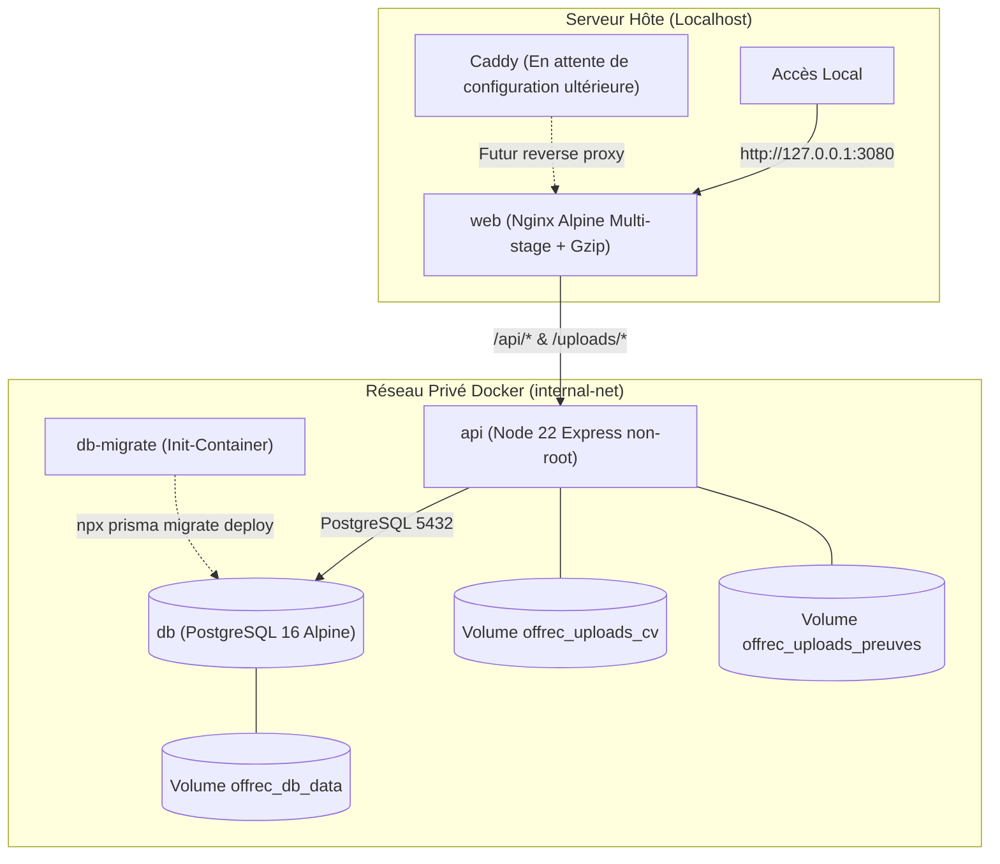

# 🐳 Guide Docker & Déploiement — OffRec

Ce document décrit l'architecture de conteneurisation en **mode production** exécutée localement sur ce serveur.

---

## 1. Architecture Locale de Production

L'application tourne de manière isolée et sécurisée en mode production, accessible localement sur `http://127.0.0.1:3080` :



---

## 2. Commandes Opérationnelles

### Démarrage
Pour construire et démarrer la stack de production en une seule commande :
```bash
docker compose up -d --build
```

### Vérifier l'état des conteneurs
```bash
docker compose ps
```

### Consulter les logs en temps réel
```bash
# Logs de l'ensemble des services
docker compose logs -f

# Logs spécifiques de l'API
docker compose logs -f api

# Logs de l'init-container de migration
docker compose logs db-migrate
```

### Accès à l'application
* **Frontend Web & API** : [http://127.0.0.1:3080](http://127.0.0.1:3080)
* Aucune interface n'est exposée sur Internet (port lié exclusivement à l'interface `127.0.0.1`).

### Arrêter l'application
```bash
docker compose down
```

---

## 3. Données et Migrations

* **Application automatique des migrations** : Le service `db-migrate` applique automatiquement les 26 migrations Prisma (`npx prisma migrate deploy`) à chaque démarrage de la stack dès que la base de données est saine (`healthy`).
* **Injecter les données de démonstration (seed optionnel)** :
  ```bash
  docker compose exec api npm run seed
  ```
* **Sauvegarde de la base de données** :
  ```bash
  docker compose exec -T db pg_dump -U offrec offrec > backup_$(date +%Y%m%d_%H%M%S).sql
  ```
