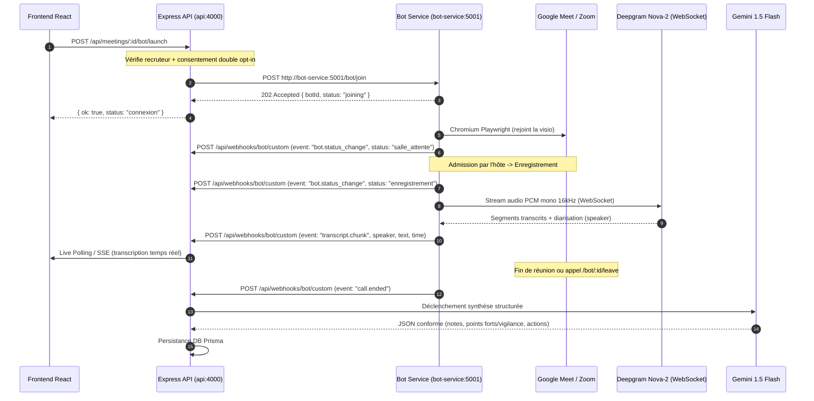

# Intégration du Microservice `bot-service` dans Docker Compose (Local & Valahla)

Ce document décrit l'intégration de production locale (Nirvana, 7.1 GiB RAM) et distante (Valahla, 5.8 GiB RAM) pour le microservice de visioconférence **Finoana Scribe** (`bot-service`).

---

## 1. Contexte d'Exécution et Dimensionnement des Ressources

| Paramètre | PC Local (Nirvana) | Serveur Production (Valahla) |
| :--- | :--- | :--- |
| **OS / Noyau** | Linux x86_64 | Debian 12 (Bookworm) |
| **RAM Totale** | 7.1 GiB | 5.8 GiB |
| **RAM Disponible** | ~1.7 GiB (5.4 GiB utilisé) | ~4.0 GiB |
| **Réseau Externe** | `127.0.0.1:3080` (Direct) | Coolify + Traefik (HTTPS `offrec.qualitec.mg`) |
| **Réseau Interne** | `internal-net` (Bridge) | `internal-net` (Bridge) |
| **Capacité Bot Simultané** | **1 session active** (max) | **1 à 2 sessions actives** (max) |
| **Plafond RAM `bot-service`** | `1280M` | `1536M` |
| **`shm_size`** | `512mb` (ou `1gb`) | `1gb` |

> [!WARNING]
> Chromium requiert une mémoire partagée (`/dev/shm`) suffisante pour WebRTC. La valeur Docker par défaut (64 Mo) entraîne un crash immédiat `SIGTRAP`. La directive `shm_size: 1gb` (ou `512mb`) est obligatoire.

---

## 2. Définition du Service dans les Docker Compose

### A. Dans `docker-compose.yml` (Local)

```yaml
  bot-service:
    build:
      context: .
      dockerfile: bot/Dockerfile
    container_name: offrec-bot-service
    restart: unless-stopped
    init: true
    shm_size: '512mb'
    deploy:
      resources:
        limits:
          cpus: '1.5'
          memory: 1280M
        reservations:
          cpus: '0.5'
          memory: 512M
    depends_on:
      api:
        condition: service_started
    environment:
      PORT: 5001
      NODE_ENV: production
      API_INTERNAL_URL: http://api:4000
      INTERNAL_BOT_SECRET: ${INTERNAL_BOT_SECRET}
      DEEPGRAM_API_KEY: ${DEEPGRAM_API_KEY}
      MAX_ACTIVE_BOTS: 1
      BOT_TIMEOUT_MINUTES: 75
    networks:
      - internal-net
    healthcheck:
      test: ["CMD-SHELL", "curl -f http://localhost:5001/health || exit 1"]
      interval: 15s
      timeout: 5s
      retries: 3
      start_period: 20s
```

### B. Dans `docker-compose.prod.yml` (Serveur Valahla)

```yaml
  bot-service:
    build:
      context: .
      dockerfile: bot/Dockerfile
    container_name: offrec-bot-service
    restart: unless-stopped
    init: true
    shm_size: '1gb'
    deploy:
      resources:
        limits:
          cpus: '1.5'
          memory: 1536M
        reservations:
          cpus: '0.5'
          memory: 512M
    depends_on:
      api:
        condition: service_started
    environment:
      PORT: 5001
      NODE_ENV: production
      API_INTERNAL_URL: http://api:4000
      INTERNAL_BOT_SECRET: ${INTERNAL_BOT_SECRET}
      DEEPGRAM_API_KEY: ${DEEPGRAM_API_KEY}
      MAX_ACTIVE_BOTS: 2
      BOT_TIMEOUT_MINUTES: 75
    networks:
      - internal-net
    healthcheck:
      test: ["CMD-SHELL", "curl -f http://localhost:5001/health || exit 1"]
      interval: 15s
      timeout: 5s
      retries: 3
      start_period: 20s
```

*Remarque de sécurité :* Le service `bot-service` n'est rattaché **qu'à `internal-net`**. Aucun port n'est exposé sur l'hôte, et aucun label Traefik n'est configuré. Il est strictement inaccessible depuis Internet.

---

## 3. Communication Inter-Services (`api` <-> `bot-service`)



### Protocoles et Sécurité :
1. **Contrôle synchrone (`api` -> `bot-service`)** :
   - Requête HTTP REST avec header `X-Internal-Secret: ${INTERNAL_BOT_SECRET}`.
   - Endpoints :
     - `POST /bot/join` : Lance une session avec `{ meetingId, meetUrl, botName }`.
     - `POST /bot/:botId/leave` : Déclenche la sortie propre de Chromium.
     - `GET /bot/:botId/status` : État instantané du processus.
     - `GET /health` : Vérifie la santé du conteneur et le nombre de sessions en cours.
2. **Événements asynchrones (`bot-service` -> `api`)** :
   - Webhook HTTP REST interne sur `http://api:4000/api/webhooks/bot/custom`.
   - Header de protection `X-Bot-Secret: ${INTERNAL_BOT_SECRET}`.
   - Événements traités : `bot.status_change`, `transcript.chunk`, `call.ended`.

---

## 4. Configuration d'Environnement

### Variables ajoutées dans `.env` (Local Nirvana) :
```ini
# Bot Visioconférence (Approche A Custom)
BOT_PROVIDER=custom_headless
BOT_SERVICE_URL=http://bot-service:5001
INTERNAL_BOT_SECRET=sec_finoana_bot_local_e814a72bc
BOT_MAX_CONCURRENT_SESSIONS=1
DEEPGRAM_API_KEY=votre_cle_deepgram_ici
```

### Variables ajoutées dans `.env.valahla` (Serveur de Prod) :
```ini
# Bot Visioconférence (Approche A Custom)
BOT_PROVIDER=custom_headless
BOT_SERVICE_URL=http://bot-service:5001
INTERNAL_BOT_SECRET=sec_finoana_bot_prod_89d3f1107c
BOT_MAX_CONCURRENT_SESSIONS=2
DEEPGRAM_API_KEY=votre_cle_deepgram_ici
```

### Injection dans le conteneur `api` (Express) :
Dans `docker-compose.yml` et `docker-compose.prod.yml`, sous `api.environment` :
```yaml
      BOT_PROVIDER: ${BOT_PROVIDER:-custom_headless}
      BOT_SERVICE_URL: ${BOT_SERVICE_URL:-http://bot-service:5001}
      INTERNAL_BOT_SECRET: ${INTERNAL_BOT_SECRET}
      BOT_MAX_CONCURRENT_SESSIONS: ${BOT_MAX_CONCURRENT_SESSIONS:-1}
```
