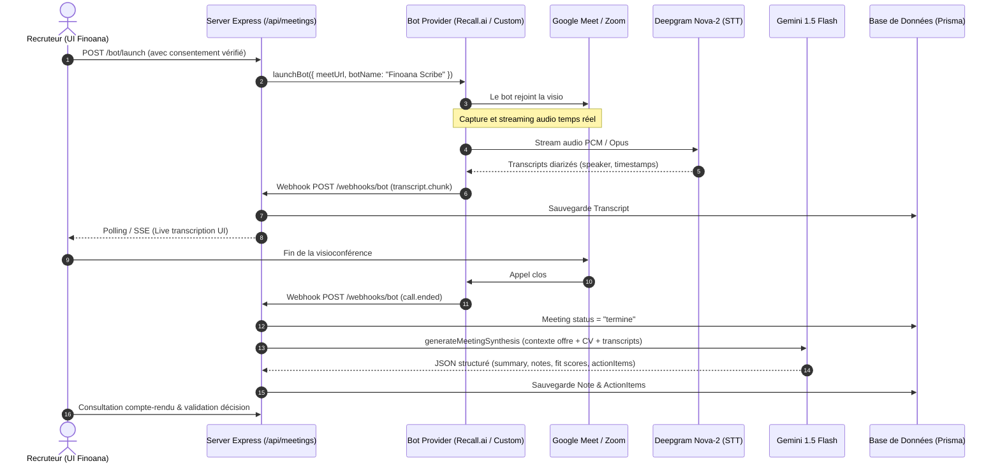

# Architecture d'Intégration : Meeting Bot, Transcription STT et Synthèse IA Gemini dans Finoana

Ce document détaille l'architecture complète d'intégration pour doter la plateforme **Finoana** (OffRec) d'un assistant de visioconférence autonome (**Finoana Scribe**). Il couvre les extensions Prisma, les endpoints Express, l'intégration du SDK Gemini existant et l'expérience utilisateur React.

---

## 1. Modèles de Données Prisma (`server/prisma/schema.prisma`)

Ces modèles s'intègrent directement aux modèles existants (`Interview`, `MatchSuggestion`, `User`, `Opportunity`).

```prisma
// ============================================================================
// Écosystème Meeting & Assistant Visioconférence (Finoana Scribe)
// ============================================================================

enum MeetingPlatform {
  google_meet
  zoom
  teams
  autre
}

enum MeetingStatus {
  planifie
  en_cours
  termine
  annule
  echec
}

enum BotProvider {
  recall_ai
  meeting_baas
  custom_headless
}

enum MeetingBotStatus {
  initialise
  connexion
  salle_attente
  en_appel
  enregistrement
  deconnexion
  termine
  erreur
}

enum SpeakerRole {
  recruteur
  candidat
  observateur
  inconnu
}

enum ActionItemPriority {
  urgente
  haute
  normale
  basse
}

enum ActionItemStatus {
  a_faire
  en_cours
  termine
  annule
}

enum NoteRecommendation {
  retenu
  second_entretien
  non_retenu
  absent
}

/// Session de réunion / visioconférence monitorée par l'assistant Finoana Scribe.
/// Liée 1:1 optionnellement à un tour d'entretien (model Interview).
model Meeting {
  id                 String            @id @default(uuid())
  title              String
  description        String?
  meetUrl            String
  platform           MeetingPlatform   @default(google_meet)
  status             MeetingStatus     @default(planifie)
  
  scheduledAt        DateTime?
  startedAt          DateTime?
  endedAt            DateTime?
  recordingUrl       String?

  /// Conformité légale : double consentement d'enregistrement recueilli (Loi 2014-038 Madagascar / RGPD)
  recruiterConsent   Boolean           @default(false)
  candidateConsent   Boolean           @default(false)
  recruiterConsentAt DateTime?
  candidateConsentAt DateTime?

  /// Rattachement au tour d'entretien OffRec (optionnel si réunion ad-hoc)
  interviewId        String?           @unique
  interview          Interview?        @relation(fields: [interviewId], references: [id], onDelete: SetNull)

  /// Hôte de la réunion (recruteur ou admin)
  hostId             String
  host               User              @relation("MeetingHost", fields: [hostId], references: [id], onDelete: Cascade)

  /// Participant principal (candidat)
  participantId      String?
  participant        User?             @relation("MeetingParticipant", fields: [participantId], references: [id], onDelete: SetNull)

  bots               MeetingBot[]
  transcripts        Transcript[]
  notes              Note[]
  actionItems        ActionItem[]

  createdAt          DateTime          @default(now())
  updatedAt          DateTime          @updatedAt

  @@index([hostId])
  @@index([participantId])
  @@index([status])
  @@index([scheduledAt])
}

/// Cycle de vie et statut de l'instance de bot dans le call.
model MeetingBot {
  id              String           @id @default(uuid())
  meetingId       String
  meeting         Meeting          @relation(fields: [meetingId], references: [id], onDelete: Cascade)
  provider        BotProvider      @default(recall_ai)
  externalBotId   String?          @unique
  botName         String           @default("Finoana Scribe")
  status          MeetingBotStatus @default(initialise)
  failureReason   String?
  joinedAt        DateTime?
  leftAt          DateTime?
  metadata        Json?
  createdAt       DateTime         @default(now())
  updatedAt       DateTime         @updatedAt

  @@index([meetingId])
  @@index([status])
}

/// Segments textuels de transcription diarizés (qui parle, à quel instant).
model Transcript {
  id          String      @id @default(uuid())
  meetingId   String
  meeting     Meeting     @relation(fields: [meetingId], references: [id], onDelete: Cascade)
  speakerName String
  speakerRole SpeakerRole @default(inconnu)
  speakerId   String?
  startTime   Float       /// secondes depuis le début de la session
  endTime     Float       /// secondes
  text        String
  confidence  Float?
  language    String      @default("fr")
  isFinal     Boolean     @default(true)
  chunkIndex  Int?
  createdAt   DateTime    @default(now())

  @@index([meetingId, startTime])
  @@index([meetingId, chunkIndex])
}

/// Compte-rendu d'évaluation et synthèse générée par Gemini 1.5 Flash.
model Note {
  id                   String              @id @default(uuid())
  meetingId            String
  meeting              Meeting             @relation(fields: [meetingId], references: [id], onDelete: Cascade)
  summary              String              /// Synthèse générale exécutive
  keyTakeaways         String[]            /// Faits marquants
  candidateStrengths   String[]            /// Points forts démontrés
  candidateWeaknesses  String[]            /// Points de vigilance / lacunes
  technicalAssessment  String?             /// Évaluation technique détaillée (markdown)
  softSkillsAssessment String?             /// Posture et communication
  culturalFitScore     Int?                /// 0 à 100
  technicalFitScore    Int?                /// 0 à 100
  recommendation       NoteRecommendation?    /// retenu, second_entretien, non_retenu, absent
  recommendedReason    InterviewResultReason? /// competences_techniques, points_forts, etc.
  rawAiResponse        Json?
  createdAt            DateTime            @default(now())
  updatedAt            DateTime            @updatedAt

  @@index([meetingId])
}

/// Actions clés et prochaines étapes issues des échanges.
model ActionItem {
  id           String             @id @default(uuid())
  meetingId    String
  meeting      Meeting            @relation(fields: [meetingId], references: [id], onDelete: Cascade)
  title        String
  description  String?
  assigneeRole SpeakerRole        @default(recruteur)
  assigneeId   String?
  assignee     User?              @relation("ActionItemAssignee", fields: [assigneeId], references: [id], onDelete: SetNull)
  dueDate      DateTime?
  priority     ActionItemPriority @default(normale)
  status       ActionItemStatus   @default(a_faire)
  createdAt    DateTime           @default(now())
  updatedAt    DateTime           @updatedAt

  @@index([meetingId, status])
}
```

### Évolution des modèles existants (`schema.prisma`)
- Dans `model User` :
  ```prisma
  hostedMeetings       Meeting[]    @relation("MeetingHost")
  participatingMeetings Meeting[]   @relation("MeetingParticipant")
  assignedActionItems  ActionItem[] @relation("ActionItemAssignee")
  ```
- Dans `model Interview` :
  ```prisma
  meeting              Meeting?
  ```

---

## 2. Architecture des Endpoints Express

### A. Contrôle et Consultation (`server/src/routes/meetings.routes.ts`)

Monté sur `/api/meetings` dans `app.ts` :

| Méthode | Route | Rôle requis | Description |
| :--- | :--- | :--- | :--- |
| `POST` | `/api/meetings/init-from-interview` | `recruiter` / `admin` | Initialise ou récupère un `Meeting` à partir d'un `interviewId` existant. |
| `GET` | `/api/meetings/:id` | `auth` (hôte/participant/admin) | Détail complet d'une réunion (statut, bot, notes, action items). |
| `POST` | `/api/meetings/:id/consent` | `auth` | Enregistre le consentement d'enregistrement des participants. |
| `POST` | `/api/meetings/:id/bot/launch` | `recruiter` / `admin` | Déclenche l'envoi du bot sur l'URL Meet/Zoom via le Provider actif. Bloqué si consentement manquant. |
| `POST` | `/api/meetings/:id/bot/leave` | `recruiter` / `admin` | Ordonne au bot d'évacuer immédiatement la visioconférence. |
| `GET` | `/api/meetings/:id/live` | `auth` | Endpoint optimisé pour le polling temps réel (statut bot + derniers segments transcript). |
| `GET` | `/api/meetings/:id/transcripts` | `auth` | Liste ordonnée de tous les segments transcrits. |
| `POST` | `/api/meetings/:id/notes/generate` | `recruiter` / `admin` | Déclenche (ou régénère) l'analyse et la synthèse via Gemini 1.5 Flash. |
| `PATCH` | `/api/meetings/:id/action-items/:itemId` | `recruiter` / `admin` | Met à jour le statut (`a_faire`, `termine`) ou la priorité d'une action. |

### B. Couche d'Abstraction Provider (`server/src/lib/bot/provider.interface.ts`)
Découplage strict entre la logique métier Finoana et le fournisseur de bot :

```typescript
export interface BotLaunchParams {
  meetingId: string
  meetUrl: string
  botName: string
  webhookCallbackUrl: string
}

export interface IMeetingBotProvider {
  launchBot(params: BotLaunchParams): Promise<{ externalBotId: string }>
  leaveBot(externalBotId: string): Promise<void>
  getBotStatus(externalBotId: string): Promise<MeetingBotStatus>
}
```
* **Fournisseur Recall.ai** : Envoie un appel REST POST `https://api.recall.ai/api/v1/bot/` avec webhook callback.
* **Fournisseur Custom Headless** : Envoie un job au microservice conteneurisé Playwright (`POST /bot/join`).

### C. Webhooks Provider-Agnostic (`server/src/routes/webhooks-bot.routes.ts`)

Monté sur `/api/webhooks/bot` :
- Sécurisé par vérification de signature HMAC SHA-256 (`X-Webhook-Signature`).
- **Événements pris en charge** :
  1. `bot.status_change` : Mappe les statuts externes vers l'enum `MeetingBotStatus` (`joining` -> `connexion`, `in_call_recording` -> `enregistrement`, etc.).
  2. `transcript.chunk` : Insère en base les segments transcrits (temps, locuteur, texte, confiance).
  3. `call.ended` :
     - Met à jour `endedAt` et le statut du `Meeting` à `termine`.
     - Marque le bot comme `termine`.
     - Déclenche automatiquement en tâche de fond le service de synthèse `generateMeetingSynthesis(meetingId)`.

---

## 3. Intégration du Service Gemini (`server/src/lib/meeting-synthesis.ts`)

S'appuie sur le client `@google/generative-ai` et le garde-fou contextuel existant dans `server/src/lib/gemini.ts`.

### Pipeline de Synthèse et d'Évaluation
1. **Extraction du Contexte Métier** :
   - Fiche de poste liée (`Opportunity` : compétences attendues, niveau d'expérience, descriptif de mission).
   - Profil candidat (`CandidateProfile` : parcours, compétences clés).
   - Transcripts horodatés concaténés avec leurs locuteurs.
2. **Garde-fou Contextuel et Anti-Injection** :
   - Exécution de `detectPromptInjection()` sur l'ensemble du transcript pour neutraliser les tentatives de jailbreak orales.
3. **Appel Gemini 1.5 Flash avec JSON Garanti (`responseSchema`)** :
   - Exploite la fenêtre de 1M tokens de `gemini-1.5-flash` pour ingérer la totalité d'un entretien de 60 min (~10 000 tokens) sans perte d'information.
   - Utilise `responseMimeType: "application/json"` avec un schéma strict :
     ```typescript
     const synthesisSchema = {
       type: SchemaType.OBJECT,
       properties: {
         summary: { type: SchemaType.STRING },
         keyTakeaways: { type: SchemaType.ARRAY, items: { type: SchemaType.STRING } },
         candidateStrengths: { type: SchemaType.ARRAY, items: { type: SchemaType.STRING } },
         candidateWeaknesses: { type: SchemaType.ARRAY, items: { type: SchemaType.STRING } },
         technicalAssessment: { type: SchemaType.STRING },
         softSkillsAssessment: { type: SchemaType.STRING },
         technicalFitScore: { type: SchemaType.INTEGER },
         culturalFitScore: { type: SchemaType.INTEGER },
         recommendation: {
           type: SchemaType.STRING,
           enum: ['retenu', 'second_entretien', 'non_retenu', 'absent'],
         },
         recommendedReason: {
           type: SchemaType.STRING,
           enum: [
             'competences_techniques',
             'experience',
             'disponibilite',
             'pretentions_salariales',
             'savoir_etre',
             'autre_candidat_retenu',
             'poste_modifie',
             'points_forts',
             'autre',
           ],
         },
         actionItems: {
           type: SchemaType.ARRAY,
           items: {
             type: SchemaType.OBJECT,
             properties: {
               title: { type: SchemaType.STRING },
               description: { type: SchemaType.STRING },
               assigneeRole: { type: SchemaType.STRING, enum: ['recruteur', 'candidat'] },
               priority: { type: SchemaType.STRING, enum: ['urgente', 'haute', 'normale', 'basse'] },
             },
             required: ['title', 'assigneeRole', 'priority'],
           },
         },
       },
       required: [
         'summary',
         'keyTakeaways',
         'candidateStrengths',
         'candidateWeaknesses',
         'technicalFitScore',
         'culturalFitScore',
         'recommendation',
         'actionItems',
       ],
     }
     ```
4. **Persistance Transactionnelle** :
   - Création de l'enregistrement `Note`.
   - Création par lot des `ActionItem`.
   - Pré-remplissage suggéré pour le modal d'issue d'entretien du recruteur (`InterviewOutcomeModal`).

---

## 4. Expérience Utilisateur React (Frontend)

L'intégration respecte scrupuleusement la charte graphique de Finoana (CSS variables `--color-accent`, `--color-ink`, `--color-bg-elevated`, typographies et composants existants `Button`, `Modal`).

### A. Intégration dans `RecruiterInterviewDetail.tsx`
Ajout d'un panneau dédié **« Assistant IA d'entretien (Finoana Scribe) »** :
- **Badge d'état dynamique** :
  - `Non démarré` (gris)
  - `Connexion à Google Meet...` (bleu pulsant)
  - `En salle d'attente (admission requise)` (ambre pulsant)
  - `En appel - Enregistrement actif` (vert avec onde sonore animée)
  - `Déconnexion...` (gris)
  - `Entretien terminé - Analyse prête` (bleu avec icône Sparkles)
- **Case à cocher obligatoire de consentement légal** :
  - *« Les participants ont été informés de la présence du bot et ont consenti à l'enregistrement et à la transcription. »* (bloque le lancement si décochée).
- **Contrôles directs** :
  - Bouton primaire : `Faire entrer le bot dans la visio`.
  - Bouton danger : `Faire quitter le bot`.

### B. Nouveaux Composants Dédiés

1. `MeetingAssistantPanel.tsx` : Contrôle de l'assistant et état de connexion.
2. `MeetingTranscriptLive.tsx` :
   - Visualisation de la transcription en direct ou différée sous forme de bulles de dialogue.
   - Couleurs de locuteurs distinctes (Recruteur = bleu accent `#1a56ff`, Candidat = violet/indigo).
   - Horodatages précis (`04:12`) et moteur de recherche plein texte sur les paroles prononcées.
3. `MeetingNotesCard.tsx` :
   - Résumé exécutif.
   - Encart comparatif en 2 colonnes : « Points forts démontrés » (vert) vs « Points de vigilance » (ambre).
   - Jauges de scores (Fit technique & Fit culturel).
   - Recommandation finale avec bouton **« Appliquer à l'issue de l'entretien »** (remplit automatiquement le formulaire d'issue d'OffRec).
   - Bouton de régénération avec Gemini.
4. `MeetingActionItems.tsx` :
   - Liste interactive des tâches extraites.
   - Cases à cocher pour marquer les tâches terminées (`PATCH /api/meetings/:id/action-items/:id`).
   - Badges de priorité et assignation claire (Recruteur vs Candidat).

---

## 5. Synthèse des Flux Opérationnels


